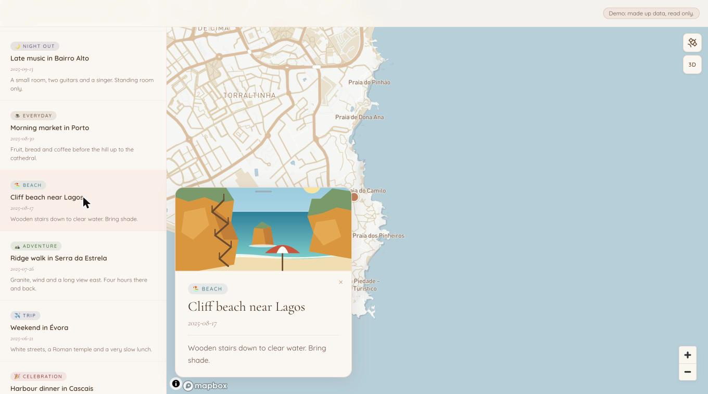

# Terrola

A private map of the places you share.

Terrola is a shared map for a small group. Pin places, add photos and notes, and see them on
a map with a warm palette. You host it yourself on Next.js, Supabase and Mapbox.

Demo: <https://terrola.vercel.app>



The hosted demo on 2026-10-13. Map: © Mapbox, © OpenStreetMap.

The demo is open and read only, on made up data: twelve invented visits to real places around
the world, each with a free public domain photo taken there.
It has no login and cannot change anything.

## What is checked

Each claim names the file that enforces it and the test or CI job that checks it. Tests are
under [`tests/unit/access/`](tests/unit/access/).

| claim | enforced in | tested in |
|-------|-------------|-----------|
| The demo never runs next to real credentials (five named variables) | [`lib/mode.ts`](lib/mode.ts), [`instrumentation.ts`](instrumentation.ts), [`proxy.ts`](proxy.ts), [`lib/demo/gate.ts`](lib/demo/gate.ts) | [`mode.spec.ts`](tests/unit/access/mode.spec.ts), [`gate.spec.ts`](tests/unit/access/gate.spec.ts) |
| The public demo refuses every write | [`proxy.ts`](proxy.ts), [`lib/demo/memory-store.ts`](lib/demo/memory-store.ts) | [`proxy-matrix.spec.ts`](tests/unit/access/proxy-matrix.spec.ts), [`memory-store.spec.ts`](tests/unit/access/memory-store.spec.ts) |
| Every path is refused unless it is listed | [`app/api/_lib/routes.ts`](app/api/_lib/routes.ts), [`proxy.ts`](proxy.ts) | [`proxy-matrix.spec.ts`](tests/unit/access/proxy-matrix.spec.ts) |
| Writes started by another site are refused | [`proxy.ts`](proxy.ts) | [`proxy-matrix.spec.ts`](tests/unit/access/proxy-matrix.spec.ts) |
| The session is signed with one key only and ends when the password changes | [`lib/session.ts`](lib/session.ts) | [`session-key.spec.ts`](tests/unit/access/session-key.spec.ts), [`csrf.spec.ts`](tests/unit/access/csrf.spec.ts) |
| A write needs a token tied to the session | [`app/api/_lib/csrf.ts`](app/api/_lib/csrf.ts) | [`csrf.spec.ts`](tests/unit/access/csrf.spec.ts) |
| Password guessing is slowed | [`app/api/_lib/login.ts`](app/api/_lib/login.ts), [`app/api/_lib/rate-limit.ts`](app/api/_lib/rate-limit.ts) | [`login.spec.ts`](tests/unit/access/login.spec.ts), [`rate-limit.spec.ts`](tests/unit/access/rate-limit.spec.ts) |
| Keep-alive needs a secret and returns no error text | [`app/api/_lib/cron.ts`](app/api/_lib/cron.ts) | [`keep-alive.spec.ts`](tests/unit/access/keep-alive.spec.ts) |
| The demo's data is made up and held in memory | [`lib/demo/fixtures.ts`](lib/demo/fixtures.ts), [`lib/demo/memory-store.ts`](lib/demo/memory-store.ts) | [`memory-store.spec.ts`](tests/unit/access/memory-store.spec.ts) |
| The demo's photos are plain JPEGs with no metadata that the app serves itself, and nothing else under `/demo` skips the proxy | [`public/demo/location-photos/`](public/demo/location-photos/), [`proxy.ts`](proxy.ts) | [`memory-store.spec.ts`](tests/unit/access/memory-store.spec.ts), [`proxy-matrix.spec.ts`](tests/unit/access/proxy-matrix.spec.ts) |
| The Mapbox wordmark and attribution are not under the list or an open place card | [`components/Map/MapCanvas.tsx`](components/Map/MapCanvas.tsx), [`components/Map/LocationCard.tsx`](components/Map/LocationCard.tsx) | [`map-credit.spec.ts`](tests/unit/access/map-credit.spec.ts), a check of the source text; the picture above is the rendered result |
| Reads and writes go through one gate that checks the caller again | [`lib/demo/gate.ts`](lib/demo/gate.ts), [`app/api/_lib/live-access.ts`](app/api/_lib/live-access.ts) | [`gate.spec.ts`](tests/unit/access/gate.spec.ts), [`live-access.spec.ts`](tests/unit/access/live-access.spec.ts), [`location-writes.spec.ts`](tests/unit/access/location-writes.spec.ts), [`photo-writes.spec.ts`](tests/unit/access/photo-writes.spec.ts) |
| The demo screen offers no control that writes, and place search is closed | [`components/Map/MapCanvas.tsx`](components/Map/MapCanvas.tsx), [`app/api/geocode/route.ts`](app/api/geocode/route.ts) | [`demo-surface.spec.ts`](tests/unit/access/demo-surface.spec.ts) |
| A pull request from a lane branch touches only that lane's files | [`LANES.json`](LANES.json), [`scripts/gates/lane-ownership.mjs`](scripts/gates/lane-ownership.mjs) | CI job `gates` in [`build.yml`](.github/workflows/build.yml) |
| Every file under `public/` is listed in [`docs/ASSETS.md`](docs/ASSETS.md) | [`scripts/gates/provenance.mjs`](scripts/gates/provenance.mjs) | CI job `gates` in [`build.yml`](.github/workflows/build.yml) |

The tests fail when a rule is removed. Eight pull requests each show this in their description
with a proof run: CI on a copy with rules weakened on purpose, where the tests for those rules
fail. They are [PR 8](../../pull/8), [PR 9](../../pull/9), [PR 10](../../pull/10),
[PR 12](../../pull/12), [PR 14](../../pull/14), [PR 18](../../pull/18),
[PR 21](../../pull/21) and [PR 30](../../pull/30).

More detail: [SECURITY.md](SECURITY.md), [PRIVACY.md](PRIVACY.md),
[docs/threat-model.md](docs/threat-model.md),
[docs/adr/0001-access-control.md](docs/adr/0001-access-control.md).

## Numbers

Counted from the repository on 2026-10-15.

- 18 unit spec files under `tests/unit/` (count of `*.spec.ts` files).
- 9 CI jobs in 4 workflows under `.github/workflows/`: `build`, `unit`, `cold-clone` and
  `gates` in `build.yml`, `check` in `no-direct-supabase.yml`, `lock` in `lockfile.yml`, and
  `target`, `axe` and `lighthouse` in `demo-quality.yml`. That workflow runs axe and
  Lighthouse CI against the live demo after each production deploy and every week (see
  [`docs/accessibility.md`](docs/accessibility.md)). The required checks are `build`, `check`, `unit`, `gates` and `cold-clone`.
- 4 gate scripts in `scripts/gates/` (brand, lane ownership, personal strings, provenance).
  Three of them run in CI today: brand, provenance and lane ownership. `cold-clone` installs
  fresh with no cache and fails if an env file exists, the Mapbox token is set, or no test
  passed.
- GitHub code scanning (CodeQL, default setup) and Dependabot security updates are on.
- 327 unit tests passed in the `unit` job on `main` at commit `12c360b`. The job prints the
  count in every CI run.
- Lighthouse scores: not measured yet.

## Run it yourself

You need Node and npm. No env file and no Mapbox token are needed for the tests.

```sh
git clone <this repository>
cd terrola
npm ci --ignore-scripts
npm test
```

To look at the app locally on made up data, start the dev server in the read only demo mode,
the same mode a hosted demo uses. Set `NEXT_PUBLIC_MAPBOX_TOKEN` to your own Mapbox token to
see the map tiles.

```sh
DEMO_MODE=1 npm run dev
```

There is also a writable demo mode, `DEMO_MODE=writable`, which runs only under the dev server
or `NODE_ENV=test`. Adding, editing and removing places works there, in memory, and is gone
when the server stops. Photo uploads answer 501 "not supported in the demo".

To use it on a phone, open your own deployment in the phone browser and add it to the home
screen. Safari: Share, then Add to Home Screen. Chrome on Android: open the menu, then Install app or Add to Home screen.

For a live copy, create a Supabase project and run
[`supabase/migrations/20260101000000_init.sql`](supabase/migrations/20260101000000_init.sql).
The variable names live mode uses are `SUPABASE_URL`, `SUPABASE_SERVICE_KEY`,
`SITE_PASSWORD_HASH`, `SESSION_SECRET` (32 or more characters), `CRON_SECRET`, `MEMBERS` and
`NEXT_PUBLIC_MAPBOX_TOKEN`. Read [SECURITY.md](SECURITY.md) and [PRIVACY.md](PRIVACY.md)
before you share the password with anyone.

## Refused or deferred

From [`SPEC.md`](SPEC.md):

- **Analytics, session replay and third party error reporting.** Not in this version. SPEC
  rule R12 forbids them, so [PRIVACY.md](PRIVACY.md) can say none is used.
- **Ads, payments, paid tiers and sponsor links.** Refused for now. They change the terms of
  the free hosting and map services the demo relies on.
- **Accounts per user.** Deferred to a later wave. Today there is one shared password.
- **Weather and tide facts, illustrated scenes, native apps.** Deferred to a later wave.

Ideas for later: many maps. Each map is shared with its own group of people, who can all add
to it; one person can be in several maps.

Known gaps, listed in [SECURITY.md](SECURITY.md):

- A signed photo link is refreshed by a read and saved back to the table on purpose, as a
  cache. See [SECURITY.md](SECURITY.md).
- A signed photo link works without the password for up to 30 days.
- The Content Security Policy is report only.
- The data route rate limit trusts a header a caller can set. The login limit does not.
- Some gates named in `SPEC.md` are not written yet.

## How it was built

The code was written with an AI coding assistant (Claude Code), directed by the owner.
`SPEC.md`, `CLAUDE.md` and `LANES.json` are the rules it worked under. The pull requests show
how each change was checked:

- The first commit was made directly. Everything after it came through a pull request with
  CI.
- PR 1 (the import of the spec and the app) and PR 6 (an edit to the spec and the rules
  files) have CI and no recorded review. The unit test job did not exist yet; PR 7 added it.
- From PR 7 on, each merged pull request has an independent review by a different model with
  fresh context, recorded as a comment on the pull request.
- The eight pull requests listed under "What is checked" also have a proof run.

This repository does not show a line by line review of the code by a human, and this README
does not claim one.

## Credits

Map data and tiles come from Mapbox. The app is built on Next.js, React, Supabase and
bcryptjs. The full dependency list is in [`package.json`](package.json).

## Licence

MIT. See [`LICENSE`](LICENSE).
